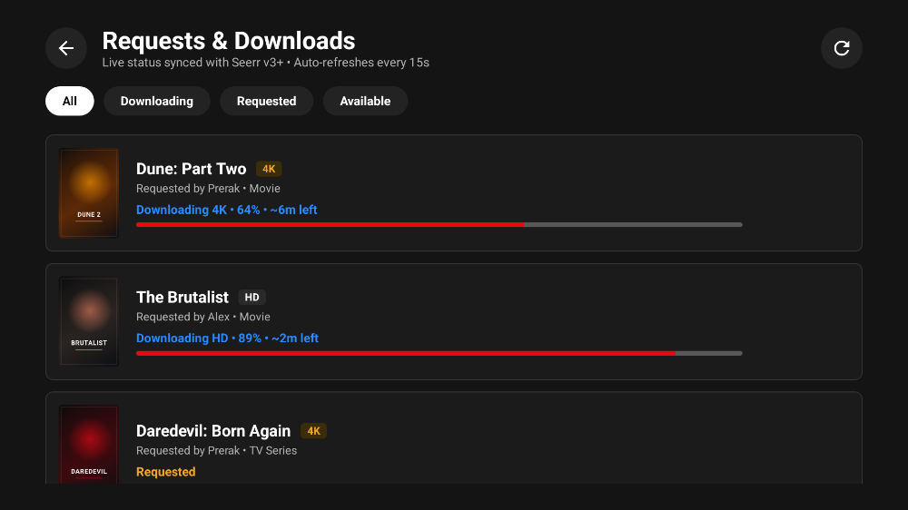
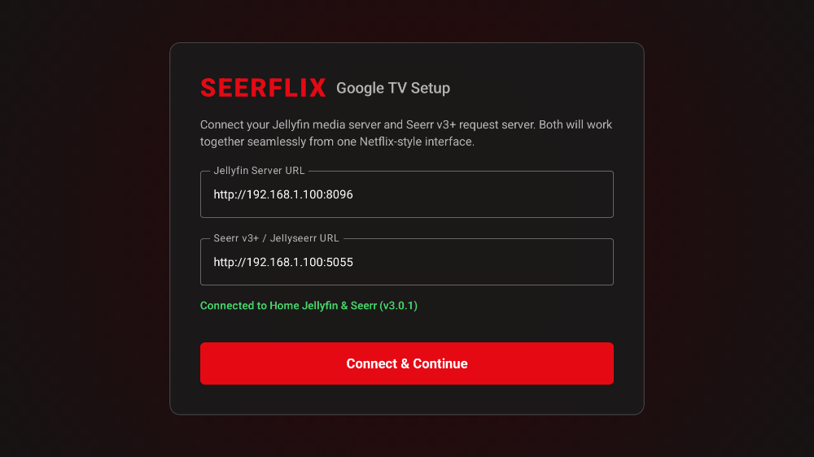

# Seerflix — Netflix-Style Google TV Client for Jellyfin + Seerr v3+

A native **Google TV / Android TV** app built with **Kotlin**, **Jetpack Compose for TV**, and **Jetpack Media3** that unifies your **Jellyfin** library and **Seerr v3+** (or Jellyseerr) into one seamless Netflix-style living room experience — with no extra middleware server required.

## Screenshots

### Home Hub & Continue Watching


### Top 10 Movies Row & Live Availability Badges


### Title Details, TV Seasons & Live 4K Download ETA


### Requests & Downloads Hub (HD & 4K Queue + Live Progress)


### "Who's Watching?" Profile Picker & Quick Connect


### Dual-Server Setup (Jellyfin + Seerr v3+)


> *Note: UI screenshots above are rendered from the real Jetpack Compose TV layouts via CashApp Paparazzi (`./gradlew recordPaparazziDebug`) using synthetic poster/backdrop preview artwork.*

## Key Features
- **Netflix TV 10-Foot UI**: Deep `#141414` dark theme, `#E50914` accents, collapsible left icon rail, dynamic preview-on-focus billboard hero, Continue Watching progress bars, and oversized **Top 10** numbered rows.
- **"Who's Watching?" Profile Picker + Quick Connect**: Sign in with a 6-digit **Quick Connect** code synced across both Jellyfin and Seerr v3+ (with password login fallback).
- **On-Device Trailer Previews**: Plays local Jellyfin trailers and Seerr YouTube `relatedVideos` directly on the Google TV via `NewPipeExtractor` + Media3 (zero load on your server, with Ken Burns backdrop fallback).
- **Seamless HD & 4K Requests + Live ETA**:
  - Request **HD (1080p)**, **4K (2160p)**, or **Both**, plus per-season selection for TV shows.
  - Tracks `status` / `status4k` and live `%` + **ETA** directly from Seerr v3+'s `downloadStatus` / `downloadStatus4k` fields (*ensure **Enable Scan** is checked on Radarr/Sonarr inside Seerr settings*).
  - Auto-polls every 15s on Details and Requests Hub so `Requested → Downloading 64% • ~6m left → Play` updates automatically.
- **Media3 Player**: Direct Play first (HEVC, H.264, AV1, HDR10/Dolby Vision) with automatic Jellyfin HLS transcode fallback, **Skip Intro**, **Next Episode** overlay, Audio/Subtitle track switcher, and live Jellyfin resume reporting.

## Build & Sideload to Google TV
1. Build the debug APK:
   ```bash
   ./gradlew assembleDebug
   ```
   Output: `app/build/outputs/apk/debug/app-debug.apk`
2. Enable **Developer Options → USB/Network Debugging** on your Google TV and install via ADB:
   ```bash
   adb connect <GOOGLE_TV_IP>:5555
   adb install -r app/build/outputs/apk/debug/app-debug.apk
   ```

## Tests & Screenshot Verification
```bash
./gradlew testDebugUnitTest
```
