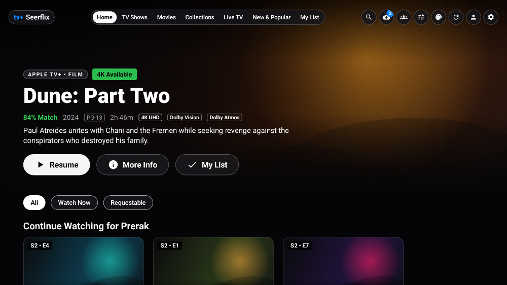
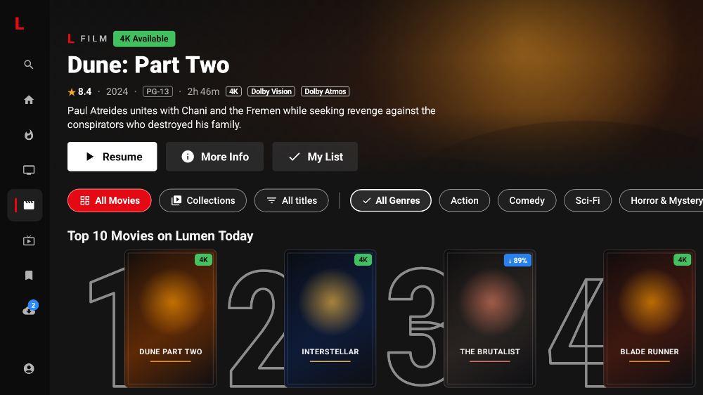
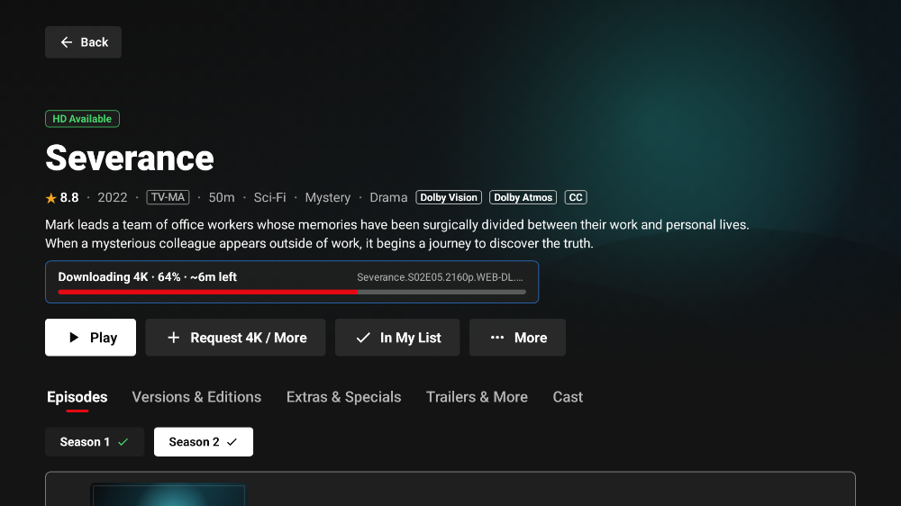
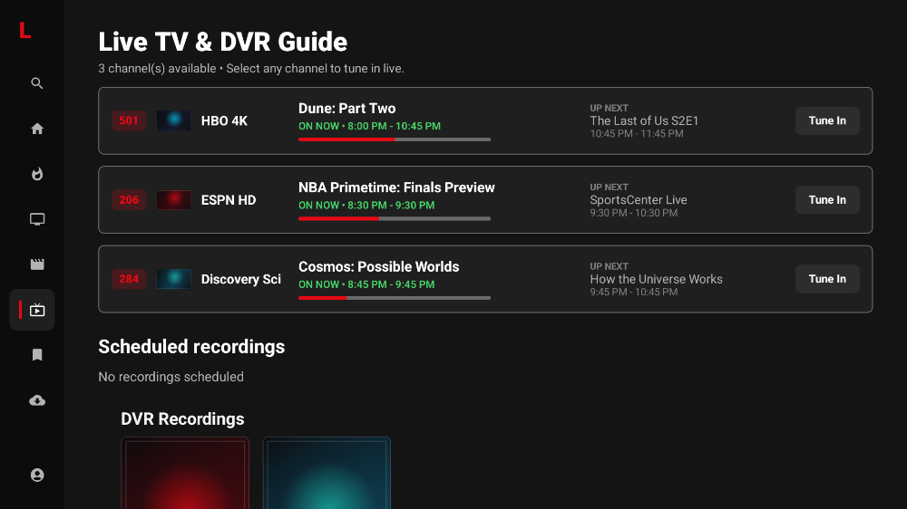
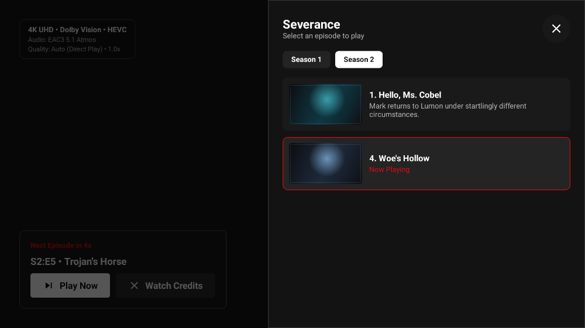
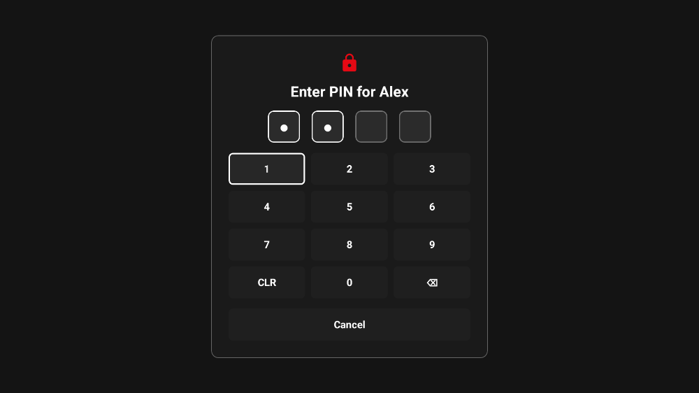

# Lumen — Customizable Google TV Client for Jellyfin + Seerr v3+

A native **Google TV / Android TV** app built with **Kotlin**, **Jetpack Compose for TV**, and **Jetpack Media3** that unifies your **Jellyfin** library and **Seerr v3+** (or Jellyseerr) into a living room streaming experience with **per-user UI Presets** (Netflix, Apple TV+, and Disney+ / Max) — with no extra middleware server required.

## Screenshots

### Per-User UI Presets

#### Netflix Preset (Default) — Collapsible Rail, Profile Menu & Compact Banner


#### Apple TV+ Preset — Floating Glass Pill Bar & 16:9 Widescreen Cards


#### Disney+ / Max Preset — Top Header Bar & Midnight Navy Gradient


#### Appearance & UI Preset Picker (Per Profile)


### Top 10 Movies Row, Genre Filters & Live Availability Badges


### Collections Hub & Saga Completion


### Title Details, Versions/Editions, TV Seasons, Extras & Live 4K Download ETA


### Live TV & DVR Guide


### Search, People & Genre Discovery


### Media3 Player Overlays (Episodes Drawer, Chapters, ASS/SSA & Stream Info)


### Requests & Downloads Hub (HD & 4K Queue, Live Progress & Admin Approvals)


### "Who's Watching?" Profile Picker, PIN Lock, Kids Mode & Manage Profiles




### Zero-Friction Setup (LAN Auto-Discovery, QR Companion, Dual Failover & Jellyfin-Only Mode)


> *Note: UI screenshots above are rendered from the real Jetpack Compose TV layouts via CashApp Paparazzi (`./gradlew testDebugUnitTest`) using synthetic poster/backdrop preview artwork.*

## Key Features
- **Lumen 1.0**:
  - **Household safety**: with a Seerr API key set, each profile now requests as its own Seerr user (linked automatically by its Jellyfin account), so requests are attributed to the right person and follow their Seerr permissions and quotas. Kids and rating-limited profiles can never request, approve or decline as the Seerr admin; the household's Jellyfin admin still approves and declines from the TV. Titles with an unrecognised rating are hidden from rating-limited profiles instead of passing as PG. Server settings in Settings now ask for a parent PIN, just like the profile picker. The PIN lockout survives restarting the app. The launcher's search no longer shows a PIN-locked profile's library.
  - **Setup & servers**: the phone setup page never sends your Seerr API key back over the network, turns away floods of connections and stops when you leave the screen. The API key is masked on the TV. Testing a server address no longer sends your sign-in to it, and a failed first-time setup no longer leaves the broken address saved. A request that times out is no longer sent a second time to your other server address.
  - **Remote & focus**: Back no longer closes the app when the row you were on disappears. Library and Details put you back on the title or episode you opened. The player's episode, channel and chapter lists open on the current item. With the controls hidden, OK presses Skip Intro / Recap, Up Next "Play now" or Undo. The first key on the paused screensaver only wakes it.
  - **Playback**: coming back to a player you left (for example after a "show details" from your phone) keeps saving your progress. Changing settings during a cinema intro no longer skips the movie. A trailer no longer rolls into an old Play All queue. Quality, burn-in and downmix streams only ask for codecs the box can play.
  - **Launcher & background**: the Watch Next row updates right after you finish watching, keeps titles in the order you really watched them, no longer piles up duplicates, and is cleared while a PIN-locked profile is active. "Ready to watch" alerts also fire for requests that download between two checks. "Show details" sent from another Jellyfin app can no longer crash Lumen, and picking a Watch Next title while something is playing no longer leaves the old player behind it. Creating a Watch Together room no longer joins someone else's room with the same name. The Requests screen makes one call per refresh instead of about fifty.
  - **Details & Home**: requests default to the quality profile and folder your Seerr admin chose. Episodes TMDB doesn't list (TVDB or absolute order) now appear. Resume and watched state are fresh right after playback. Customize Home keeps the order of rows it didn't show. My List, collections, playlists and recordings are no longer cut off at 100 (40 for recordings). The Live TV list follows the clock.
- **Release Polish (0.9.4)**:
  - **Live TV**: the guide now covers the full 36 hours on large lineups, keeps "now" current while open, refreshes after you return from a channel, lines up on local half-hours in every time zone and follows the TV's 12/24-hour clock. Changing channel releases the previous tuner. Recordings use the server's DVR padding and series defaults unless you change them. Recordings, Kids profiles and the launcher's Watch Next row respect rating limits.
  - **Playback**: Up Next follows shuffle and playlist queues. An audio track picked before playback now plays on Direct Play, and "Off" in the track picker really turns subtitles off. Subtitle choices survive quality, audio and version switches. A failed cinema intro is skipped instead of ending playback. The sleep timer no longer lets the next episode autoplay. Passthrough off now decodes Dolby audio on the box, so audio sync works.
  - **Screensaver & Home**: waking the screensaver keeps your place (Back no longer exits the app). The screensaver also no longer starts while a dialog is open or after you come back from the background, and trailers and theme songs pause under it. Switching tabs no longer flashes the previous tab's rows, and deleted titles disappear from Home and library grids right away.
  - **Fully localized**: every screen, message, row title and badge is now translated in `en`, `es`, `fr`, `de` and `ja`.
- **Jellyfin Video Parity & Living-Room Polish (new in 0.9.3)**:
  - **HLS Audio Switching, PGS/VobSub Burn-In & Bundled FFmpeg Audio**: Switch any server audio track cleanly during HLS/transcoded streams, burn in image subtitles (`PGS` / `VobSub` / `DVBSub`) on demand or in HLS mode, and decode AC3/E-AC3/DTS/TrueHD/Vorbis/FLAC/Opus locally in PCM via Jellyfin's `media3-ffmpeg-decoder` (with a Settings toggle).
  - **Smart & Forced-Only Subtitles + Server Preference Sync**: Supports Jellyfin's `Default`, `Smart`, `Only Forced`, `Always`, and `None` subtitle modes and pulls user audio/subtitle defaults from `/Users/{userId}`.
  - **Pro Player Controls & Live Stats for Nerds**: Aspect ratio/zoom cycling (`Fit`, `Fill / Crop`, `Stretch`), audio sync offset (`±1000ms`), Sleep Timer + optional **"Still Watching?"** binge limit, lower remote bitrate presets (`1080p 8 Mbps`, `720p 4 Mbps`, `480p 1.5 Mbps`) + Home server bitrate cap, complete Jellyfin Active Devices session reporting, and live **Stats for Nerds** (actual Play Method, transcode reasons, decoders, buffer, dropped frames).
  - **True "Next Up", Per-Library Grids, Folder View & Playlists**: Integrates `/Shows/NextUp` across connected servers (merged into Continue Watching or as a dedicated row), opens any individual video library (*Anime*, *4K Movies*, *Home Videos*, *Music Videos*, etc.) as a full paged grid with optional **Folder View**, adds Jellyfin **Playlists** + **Play All / Shuffle** playback queues (including multi-item remote Play/PlayNext/NextTrack), and brings Jellyfin-native People Search & Filmography, Play from Beginning, Per-Season/Episode Mark Watched, Media Info, Pre-Playback Track Picker, and `CanDelete` two-step deletion.
  - **2D Time-Grid EPG, Channel Surfing & DVR Options**: Switch Live TV between List and a 36-hour **2D Time-Grid EPG** with category/favorites filters (`All`, `Favorites`, `Movies`, `Sports`, `News`, `Kids`), favorite channel starring, in-player **Channel Switcher** + `CH+`/`CH-` surfing, and DVR pre/post padding + series options (`New episodes only`, `Record on any channel`).
  - **Living-Room Polish**: Configurable **OLED Backdrop & Drifting Clock Screensaver** (on idle browse/details and paused playback, respecting Kids Mode ratings), optional **Cinema Intros** pre-rolls, and optional ambient **Theme Songs** on Details pages — all localized across `en`, `es`, `fr`, `de`, and `ja`.
- **Easier to Navigate (new in 0.9)**:
  - **Shorter nav**: just the places you go — Search, Home, New & Popular, TV Shows, Movies, Live TV, My List and Requests. Watch Together, Customize Home, Appearance, Refresh, App Update and Settings moved into the **profile menu** at the bottom of the rail (or the avatar in the Apple TV+ / Disney+ top bars). Collections lives inside Movies.
  - **Home shows more**: a shorter banner, so the whole first row is on screen at launch with focus already on its first card. Once you scroll into the rows, a compact header keeps the focused title's name, rating, details and synopsis on screen.
  - **Predictable remote**: Left (or Up) into the nav lands on the tab you are on; coming back lands on the row and card you left; each row remembers its position; each tab remembers how far down you were. Back goes to the top of the page, then the nav, then exits.
  - **Cards you can scan**: titles under every poster, no more PLAY badge on every card, Continue Watching shows "S2 E4 · 32m left".
  - **Rebuilt Top 10 numbers**: thicker condensed numerals that sit on the poster's baseline, tuck under it by the same amount for every rank, and light up when focused.
  - **Real ratings**: "84% Match" (which was just the TMDB score × 10) is replaced by the actual ★ rating, and every number uses fixed-width digits and one separator style.
  - **Library grid**: one **Sort & Filter** button opens a side panel (sort, watched filter, genre); a thin **A–Z strip** down the right side replaces the row of 28 letter chips. You land in the grid right away.
  - **Details**: three main buttons (Play/Resume, Request, My List) plus a **More** menu (trailer, external player, mark watched, remind me, report issue, remove progress, cancel request); download status appears once; Episodes, Versions, Extras, Trailers, Cast, Collection and More Like This are tabs instead of one long page.
- **Per-User UI Presets & Customizable Home**: Each profile independently chooses and persists its own streaming UI layout (`Netflix`, `Apple TV+`, or `Disney+ / Max`), default startup tab, pinned Jellyfin library rows, and hidden/reordered Home rows.
- **Zero-Friction Onboarding & Smart Networking**:
  - **Jellyfin-Only Mode**: Skip Seerr/Jellyseerr entirely and browse/stream your Jellyfin libraries directly.
  - **LAN Auto-Discovery + QR Phone Companion**: Discovers Jellyfin servers via UDP `7359` broadcast and hosts a temporary local HTTP form reachable by scanning an on-screen QR code from your phone — no typing URLs with a TV remote.
  - **Dual Local/Remote Failover & Self-Signed SSL**: Configure separate LAN and remote URLs per server with automatic failover when roaming, plus an optional self-signed certificate toggle for homelab setups.
- **Plays Right on Every TV (new in 0.7)**:
  - **Device-Aware Playback**: Lumen reads the box's decoders (H.264 / HEVC 8- & 10-bit / VP9 / AV1, max resolution per codec), the screen's HDR support (HDR10, HDR10+, HLG, Dolby Vision) and what the TV or receiver accepts over HDMI (AC3, E-AC3, DTS, TrueHD), and sends Jellyfin a matching device profile. HDR on an SDR screen is tone-mapped by the server, Dolby Vision profile 5/7 only direct-plays on Dolby Vision hardware, DTS/TrueHD is converted when nothing downstream can play it, and missing codecs are transcoded instead of failing. For HDR content on SDR TVs, turn on tone mapping in Jellyfin (Dashboard → Playback → Transcoding), otherwise converted HDR looks washed out. A **Match this TV's capabilities** switch in Settings falls back to the old "allow everything" profile if detection is ever wrong.
  - **Media Session**: "Hey Google, pause", HDMI-CEC / Bluetooth remote media keys and the system playback controls work in the player.
- **Remote Control, SyncPlay & Live Updates (new in 0.7)**:
  - **"Play on" this TV**: Lumen keeps a live WebSocket connection to Jellyfin while it is on screen, so the TV shows up as a cast target in Jellyfin for web, iOS, Android and desktop — start playback, pause, seek, skip, stop or send an on-screen message from your phone. Can be switched off in Settings.
  - **Real Jellyfin SyncPlay**: Watch Together now follows the server's timed group commands (clock-synced to the server), reports buffering/ready like the official clients, and loads whatever the group switches to.
  - **Live Library Updates**: Home refreshes in place when titles are added or removed on the server and when watch progress changes on another device.
- **Home Theater & Codec Compatibility**:
  - **ASS / SSA Anime Subtitles**: Renders styled ASS/SSA dialogue overlays natively via Media3, or switches cleanly between Server Burn-In and Plain Text fallback.
  - **Audio Passthrough & Stereo Downmix**: Toggle optical/HDMI bitstream passthrough or 2.0 stereo downmix in-player.
  - **Multi-Version & Edition Picker**: Switch between 4K Remux, 1080p Web-DL, Director's Cut, or Extended editions right on Details or inside the player.
  - **Chapters, External Player & Auto-Skip**: Visual chapter tick marks on the seekbar with chapter jump list, `ACTION_VIEW` external player fallback (Kodi / Nova / MX / VLC), **24fps frame-rate matching**, **Auto-Skip Intro/Recap** (with Undo pill), **Subtitle Sync Offset (±ms)**, and **On-Demand Jellyfin Remote Subtitle Search/Download**.
- **Complete Seerr v3+ Loop**:
  - Request **HD (1080p)**, **4K (2160p)**, or **Both**, choose **Radarr / Sonarr Server, Quality Profile & Root Folder**, and select individual TV seasons.
  - **Admin Queue & Issue Reporting**: Seerr admins can **Approve** or **Decline** pending requests straight from the TV UI, and any user can **Report an Issue** (Video, Audio, Subtitle, Other) from Details.
  - **Live ETA & Background Ready Alerts**: Polls `downloadStatus` / `downloadStatus4k` every 15s, plus a **WorkManager** background check that promotes newly fulfilled requests into **"Ready to Watch"** and syncs to the Android TV Home **Watch Next** channel.
- **Household, Kids Mode & Social**:
  - **Kids Mode & Parental Filtering**: Restricts Home, Search, People, Genres, Live TV, and Requests by MPAA/TV maturity rating (`G`, `PG`, `TV-Y`, `TV-G`, `TV-PG`) with optional **4-digit Profile PIN lock** on adult profiles.
  - **Jellyfin SyncPlay**: Create, join, and sync **Watch Together** rooms directly from the top bar or player.
  - **Mark Watched / Unwatched** and Quick Connect 6-digit TV login.
- **Library Browsing (new in 0.7)**: **All Movies / All TV Shows** grids paged from the server with sort (A-Z, date added, release date, rating, random), Unwatched / Watched / Favorites filters and genre filter in a Sort & Filter panel, and an A-Z strip down the right side (0.9).
- **Settings, Subtitles & Diagnostics (new in 0.7)**:
  - A dedicated **Settings** screen for playback (capability matching, passthrough, downmix, frame-rate matching, autoplay, auto-skip), remote control and server connection.
  - **Subtitle Styling**: text size, color (white / yellow / cyan / green / grey), background opacity, edge style (outline, drop shadow, raised, none) and position, with a live preview.
  - **Crash Reports & Log Upload**: after a crash Lumen offers to store a report on *your own* Jellyfin server (Dashboard → Logs); **Send logs** in Settings uploads device info, detected playback support and the recent app log with sign-in tokens removed. Nothing is sent anywhere else.
- **Live TV & DVR, Collections, Coming Soon & Extras**:
  - Dedicated **Live TV** tab with EPG Now/Next timeline bars, live channel tuning, DVR recordings, and **DVR scheduling** (new in 0.7): hold OK on a channel to record the current or next programme or the whole series, see REC badges in the guide, and cancel from the **Scheduled recordings** list.
  - **Collections & Saga Completion** (`Part of Saga` + 1-click `Request Missing`), **Coming Soon** countdown reminders, **Extras & Special Features** row on Details, **On-Device YouTube Trailers** (`NewPipeExtractor`), **In-App GitHub Release Updater**, and localized UI (`English`, `Español`, `Français`, `Deutsch`, `日本語`) + metadata language support.

> Lumen is video-focused: music, photo and audiobook libraries are not shown.

## Build & Sideload to Google TV
The easiest option is the APK attached to the latest [GitHub release](../../releases/latest). To build it yourself:

1. Build the optimized release APK (R8-shrunk, with a baseline profile so ART precompiles the app at install time):
   ```bash
   ./gradlew assembleRelease
   ```
   Output: `app/build/outputs/apk/release/app-release.apk`

   > Use the release build on your TV. Debug builds (`assembleDebug`) run unoptimized Compose code and feel noticeably laggy on low-end sticks like the onn. 4K.
2. Enable **Developer Options → USB/Network Debugging** on your Google TV and install via ADB:
   ```bash
   adb connect <GOOGLE_TV_IP>:5555
   adb install -r app/build/outputs/apk/release/app-release.apk
   ```

### Top 10 charts (optional Trakt key)
"Top 10 Movies Out Right Now" and "Top 10 TV Shows Airing Now" rank what Trakt members watched this week. Create a free API app at [trakt.tv/oauth/applications](https://trakt.tv/oauth/applications/new) (any redirect URI, e.g. `urn:ietf:wg:oauth:2.0:oob`) and put its **Client ID** in `local.properties`:
```properties
trakt.clientId=YOUR_CLIENT_ID
```
For GitHub release builds, add it as the `TRAKT_CLIENT_ID` repository secret. Without a key those two rows fall back to TMDB popularity through Seerr. Either way, titles that aren't released yet never appear in a Top 10 row; they're in the Coming Soon rows instead.

## Tests & Screenshot Verification
```bash
./gradlew testDebugUnitTest
```
