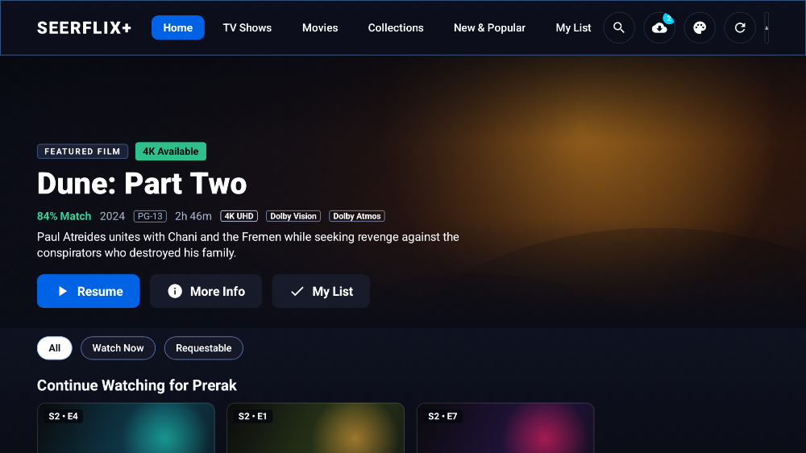
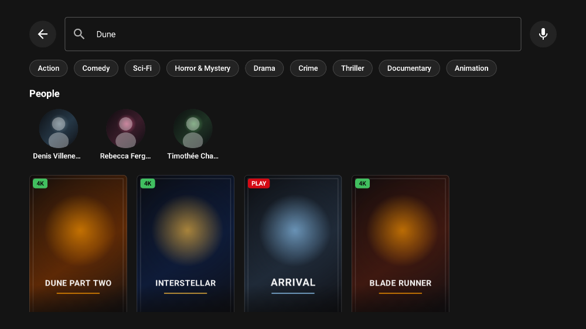
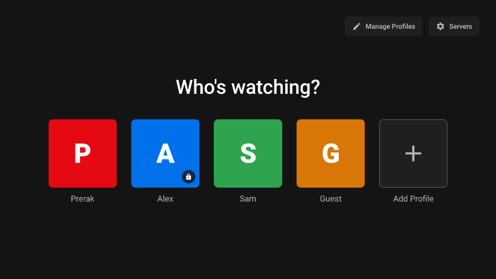
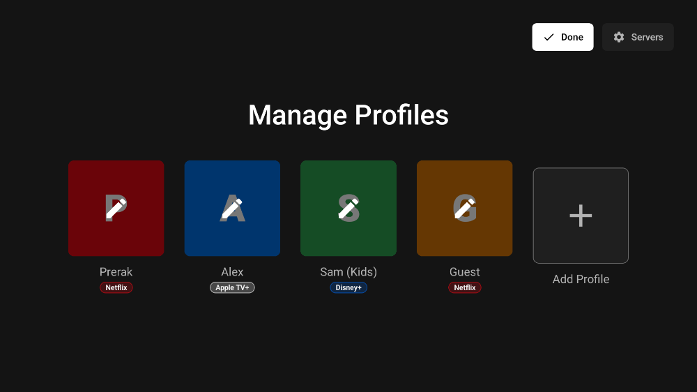

# Lumen — Customizable Google TV Client for Jellyfin + Seerr v3+

A native **Google TV / Android TV** app built with **Kotlin**, **Jetpack Compose for TV**, and **Jetpack Media3** that unifies your **Jellyfin** library and **Seerr v3+** (or Jellyseerr) into a living room streaming experience with **per-user UI Presets** (Netflix, Apple TV+, and Disney+ / Max) — with no extra middleware server required.

## Screenshots

### Per-User UI Presets

#### Netflix Preset (Default) — Collapsible Rail & Top 10 Numerals


#### Apple TV+ Preset — Floating Glass Pill Bar & 16:9 Widescreen Cards


#### Disney+ / Max Preset — Top Header Bar & Midnight Navy Gradient


#### Appearance & UI Preset Picker (Per Profile)


### Top 10 Movies Row, Genre Filters & Live Availability Badges


### Collections Hub & Saga Completion


### Title Details, Versions/Editions, TV Seasons, Extras & Live 4K Download ETA


### Live TV & DVR Guide


### Search, People & Genre Discovery


### Media3 Player Overlays (Episodes Drawer, Chapters, ASS/SSA & Stream Info)


### Requests & Downloads Hub (HD & 4K Queue, Live Progress & Admin Approvals)


### "Who's Watching?" Profile Picker, PIN Lock, Kids Mode & Manage Profiles




### Zero-Friction Setup (LAN Auto-Discovery, QR Companion, Dual Failover & Jellyfin-Only Mode)


> *Note: UI screenshots above are rendered from the real Jetpack Compose TV layouts via CashApp Paparazzi (`./gradlew testDebugUnitTest`) using synthetic poster/backdrop preview artwork.*

## Key Features
- **Per-User UI Presets & Customizable Home**: Each profile independently chooses and persists its own streaming UI layout (`Netflix`, `Apple TV+`, or `Disney+ / Max`), default startup tab, pinned Jellyfin library rows, and hidden/reordered Home rows.
- **Zero-Friction Onboarding & Smart Networking**:
  - **Jellyfin-Only Mode**: Skip Seerr/Jellyseerr entirely and browse/stream your Jellyfin libraries directly.
  - **LAN Auto-Discovery + QR Phone Companion**: Discovers Jellyfin servers via UDP `7359` broadcast and hosts a temporary local HTTP form reachable by scanning an on-screen QR code from your phone — no typing URLs with a TV remote.
  - **Dual Local/Remote Failover & Self-Signed SSL**: Configure separate LAN and remote URLs per server with automatic failover when roaming, plus an optional self-signed certificate toggle for homelab setups.
- **Home Theater & Codec Compatibility**:
  - **ASS / SSA Anime Subtitles**: Renders styled ASS/SSA dialogue overlays natively via Media3, or switches cleanly between Server Burn-In and Plain Text fallback.
  - **Audio Passthrough & Stereo Downmix**: Toggle optical/HDMI bitstream passthrough or 2.0 stereo downmix in-player.
  - **Multi-Version & Edition Picker**: Switch between 4K Remux, 1080p Web-DL, Director's Cut, or Extended editions right on Details or inside the player.
  - **Chapters, External Player & Auto-Skip**: Visual chapter tick marks on the seekbar with chapter jump list, `ACTION_VIEW` external player fallback (Kodi / Nova / MX / VLC), **24fps frame-rate matching**, **Auto-Skip Intro/Recap** (with Undo pill), **Subtitle Sync Offset (±ms)**, and **On-Demand Jellyfin Remote Subtitle Search/Download**.
- **Complete Seerr v3+ Loop**:
  - Request **HD (1080p)**, **4K (2160p)**, or **Both**, choose **Radarr / Sonarr Server, Quality Profile & Root Folder**, and select individual TV seasons.
  - **Admin Queue & Issue Reporting**: Seerr admins can **Approve** or **Decline** pending requests straight from the TV UI, and any user can **Report an Issue** (Video, Audio, Subtitle, Other) from Details.
  - **Live ETA & Background Ready Alerts**: Polls `downloadStatus` / `downloadStatus4k` every 15s, plus a **WorkManager** background check that promotes newly fulfilled requests into **"Ready to Watch"** and syncs to the Android TV Home **Watch Next** channel.
- **Household, Kids Mode & Social**:
  - **Kids Mode & Parental Filtering**: Restricts Home, Search, People, Genres, Live TV, and Requests by MPAA/TV maturity rating (`G`, `PG`, `TV-Y`, `TV-G`, `TV-PG`) with optional **4-digit Profile PIN lock** on adult profiles.
  - **Jellyfin SyncPlay**: Create, join, and sync **Watch Together** rooms directly from the top bar or player.
  - **Mark Watched / Unwatched** and Quick Connect 6-digit TV login.
- **Live TV & DVR, Collections, Coming Soon & Extras**:
  - Dedicated **Live TV** tab with EPG Now/Next timeline bars, live channel tuning, and DVR recordings.
  - **Collections & Saga Completion** (`Part of Saga` + 1-click `Request Missing`), **Coming Soon** countdown reminders, **Extras & Special Features** row on Details, **On-Device YouTube Trailers** (`NewPipeExtractor`), **In-App GitHub Release Updater**, and localized UI (`English`, `Español`, `Français`, `Deutsch`, `日本語`) + metadata language support.

## Build & Sideload to Google TV
The easiest option is the APK attached to the latest [GitHub release](../../releases/latest). To build it yourself:

1. Build the optimized release APK (R8-shrunk, with a baseline profile so ART precompiles the app at install time):
   ```bash
   ./gradlew assembleRelease
   ```
   Output: `app/build/outputs/apk/release/app-release.apk`

   > Use the release build on your TV. Debug builds (`assembleDebug`) run unoptimized Compose code and feel noticeably laggy on low-end sticks like the onn. 4K.
2. Enable **Developer Options → USB/Network Debugging** on your Google TV and install via ADB:
   ```bash
   adb connect <GOOGLE_TV_IP>:5555
   adb install -r app/build/outputs/apk/release/app-release.apk
   ```

## Tests & Screenshot Verification
```bash
./gradlew testDebugUnitTest
```
