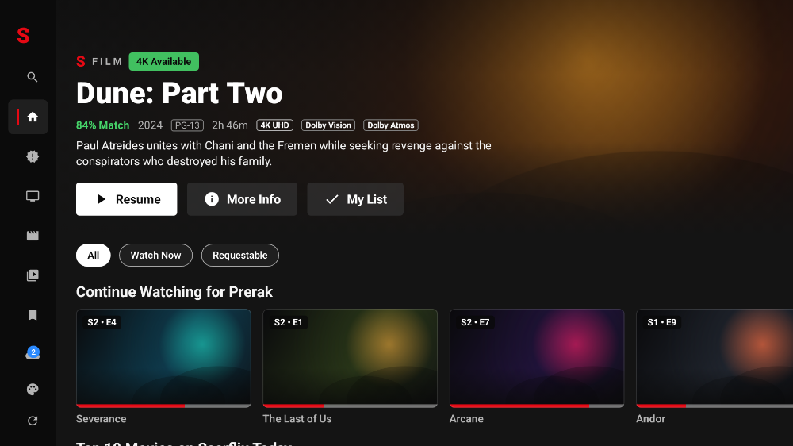
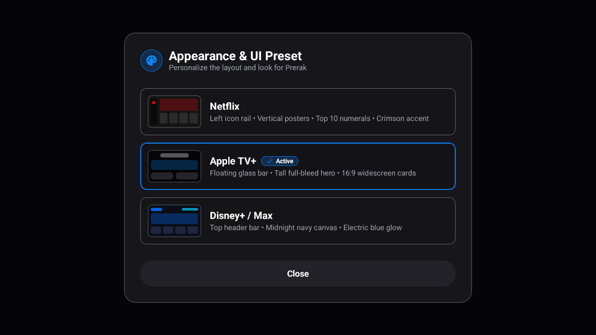
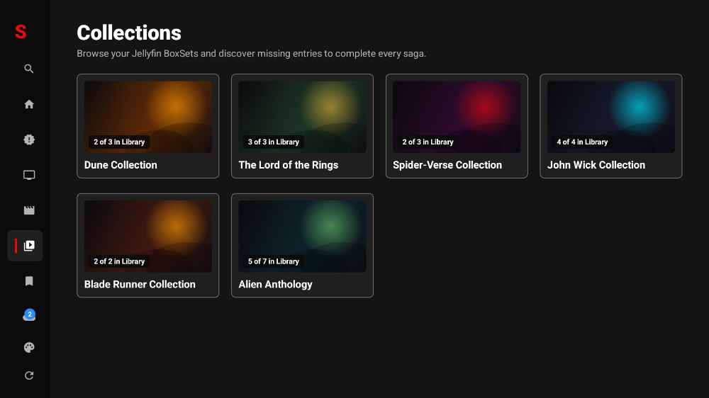

# Seerflix — Customizable Google TV Client for Jellyfin + Seerr v3+

A native **Google TV / Android TV** app built with **Kotlin**, **Jetpack Compose for TV**, and **Jetpack Media3** that unifies your **Jellyfin** library and **Seerr v3+** (or Jellyseerr) into a living room streaming experience with **per-user UI Presets** (Netflix, Apple TV+, and Disney+ / Max) — with no extra middleware server required.

## Screenshots

### Per-User UI Presets

#### Netflix Preset (Default) — Collapsible Rail & Top 10 Numerals


#### Apple TV+ Preset — Floating Glass Pill Bar & 16:9 Widescreen Cards


#### Disney+ / Max Preset — Top Header Bar & Midnight Navy Gradient


#### Appearance & UI Preset Picker (Per Profile)


### Top 10 Movies Row, Genre Filters & Live Availability Badges


### Collections Hub & Saga Completion


### Title Details, TV Seasons & Live 4K Download ETA


### Search, People & Genre Discovery


### Media3 Player Overlays (Episodes Drawer, Stream Info & Next Episode)


### Requests & Downloads Hub (HD & 4K Queue + Live Progress)


### "Who's Watching?" Profile Picker & Manage Profiles


### Dual-Server Setup (Jellyfin + Seerr v3+)


> *Note: UI screenshots above are rendered from the real Jetpack Compose TV layouts via CashApp Paparazzi (`./gradlew testDebugUnitTest`) using synthetic poster/backdrop preview artwork.*

## Key Features
- **Per-User UI Presets**: Each profile independently chooses and persists its own streaming UI layout and theme — switch anytime from the Home Appearance button or Manage Profiles:
  - **Netflix** *(default)*: `#141414` dark surface, `#E50914` crimson accents, collapsible left icon rail, `2:3` vertical posters, and giant outlined **Top 10** numerals.
  - **Apple TV+**: `#050507` obsidian canvas, floating translucent top glass pill bar, tall `360.dp` full-bleed hero with capsule buttons, `16:9` widescreen artwork cards, and `#1` Top 10 corner pills.
  - **Disney+ / Max**: `#0B0D17` midnight navy gradient canvas, structured top header bar, `#0063E5` / `#00D2FF` electric blue accents, framed `2:3` posters, and `TOP N` badges.
- **Collections & Saga Completion**: Dedicated **Collections** hub and Movie Details **"Part of Saga"** rows merging Jellyfin BoxSets with Seerr collection metadata and 1-click **Request Missing**.
- **Coming Soon & Release Reminders**: Countdown badges (`Today`, `S3 E4 • Tonight`, `Tomorrow`, `In N days`), Jellyfin `Shows/Upcoming` (**New Episodes Coming This Week**), and **"Ready to Watch • Your Reminders"** promotion when reminders become playable.
- **"Who's Watching?" Profile Picker + Quick Connect**: Sign in with a 6-digit **Quick Connect** code synced across both Jellyfin and Seerr v3+ (with optional per-profile PIN lock, preset badges, and password login fallback).
- **On-Device Trailer Previews**: Plays local Jellyfin trailers and Seerr YouTube `relatedVideos` directly on the Google TV via `NewPipeExtractor` + Media3 (zero load on your server, with Ken Burns backdrop fallback).
- **Seamless HD & 4K Requests + Live ETA**:
  - Request **HD (1080p)**, **4K (2160p)**, or **Both**, plus per-season selection for TV shows and quick-request long-press menus.
  - Tracks `status` / `status4k` and live `%` + **ETA** directly from Seerr v3+'s `downloadStatus` / `downloadStatus4k` fields (*ensure **Enable Scan** is checked on Radarr/Sonarr inside Seerr settings*).
  - Auto-polls every 15s on Details and Requests Hub so `Requested → Downloading 64% • ~6m left → Play` updates automatically.
- **Media3 Player**: Direct Play first (HEVC, H.264, AV1, HDR10/Dolby Vision) with automatic Jellyfin HLS transcode fallback, **24fps frame-rate matching**, **Auto-Skip Intro/Recap** (with Undo pill), **Subtitle Sync Offset (±ms)**, **On-Demand Jellyfin Remote Subtitle Search/Download**, **Next Episode** overlay, In-Player Episodes drawer, and live Jellyfin resume reporting.

## Build & Sideload to Google TV
1. Build the debug APK:
   ```bash
   ./gradlew assembleDebug
   ```
   Output: `app/build/outputs/apk/debug/app-debug.apk`
2. Enable **Developer Options → USB/Network Debugging** on your Google TV and install via ADB:
   ```bash
   adb connect <GOOGLE_TV_IP>:5555
   adb install -r app/build/outputs/apk/debug/app-debug.apk
   ```

## Tests & Screenshot Verification
```bash
./gradlew testDebugUnitTest
```
